  

  
  
  

## 👋 Hi, I'm Kah Yan

I build real-time software in **C++ and OpenGL**. I'm a Year 3 Computer Science student at the Singapore Institute of Technology (SIT), in the Real-Time Interactive Simulation (RTIS) degree run with DigiPen. Before that, I studied electronics and mechatronics and worked in a network operations centre, so I like knowing how things work from the hardware up.

- 🗺️ **Now:** map rendering developer on a 9-person autonomous vehicle simulation team
- 🎓 **Studying:** BSc Computer Science (RTIS), SIT-DigiPen, graduating April 2028
- 🌐 **Before:** Network Operations Center intern at Westcon Group (Cisco Meraki)
- 🔎 **Looking for:** a 1-year Integrated Work Study Programme (IWSP) placement from May 2027

## 🚗 Featured work

### Autonomous Vehicle Simulation & Visualisation Platform
`C++` `Qt` `OpenGL` · team of 9 · Sep 2026 to now

A real-time simulation that shows autonomous vehicles driving through a city map. **My part: the map renderer.**
- Built the OpenGL renderer (shaders, geometry upload, per-frame draw loop) that draws roads, buildings and points of interest, and integrated it into the main Qt app
- Built the map camera: pan and zoom that stay anchored to the cursor, and screen-to-ground coordinate conversion
- Cut repeated database queries with zoom-based level-of-detail filtering and cached bounds, checked with timing logs
- Added route playback: the planned route and an animated vehicle marker, synced to each frame

### Sudoku Rush: Networked Multiplayer Game
`C++` `Win32` `TCP/UDP` `SQLite` · team of 2 · Mar 2026

Multiplayer Sudoku over a client-server connection: TCP for logins, rooms and chat, and UDP for fast gameplay updates. **I led the client and networking code**, plus the Win32 interface and audio.
▶️ [Watch the demo](https://youtu.be/1zpRgxMpxo0)

### Network Operations Center Internship, Westcon Group
`Cisco Meraki` `Ekahau` · Mar to Aug 2023

Handled support tickets across Cisco Meraki, Palo Alto, Juniper and F5, alerted clients to outages longer than 5 minutes, moved a client's public Wi-Fi login from Facebook to SMS, and co-produced a router and server configuration guide that engineers use.
▶️ [Watch the config guide](https://youtu.be/ap5H1yltEnU)

## 🛠️ Tech stack

  

<!-- SNAKE: uncomment after the snake workflow has run once

  

-->

## 📫 Get in touch

Happy to talk about real-time rendering, simulation, or IWSP and internship roles. Email me at **2403246@sit.singaporetech.edu.sg**.
